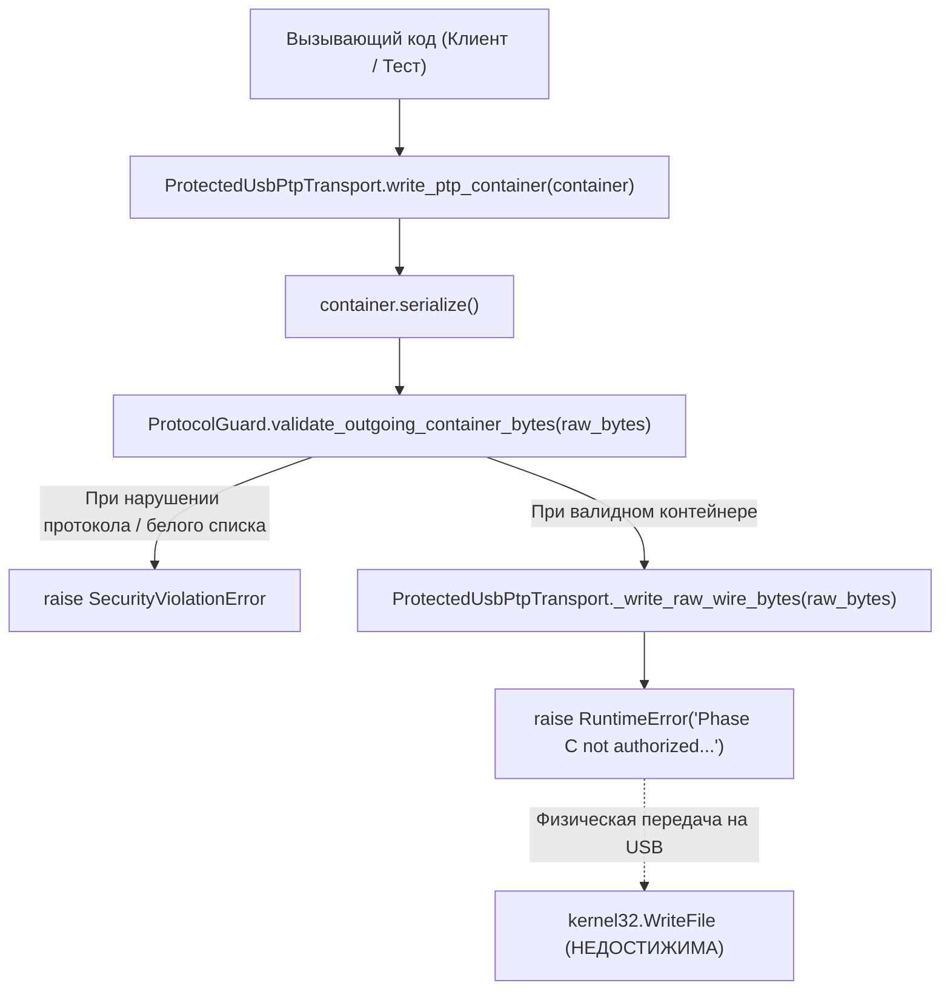
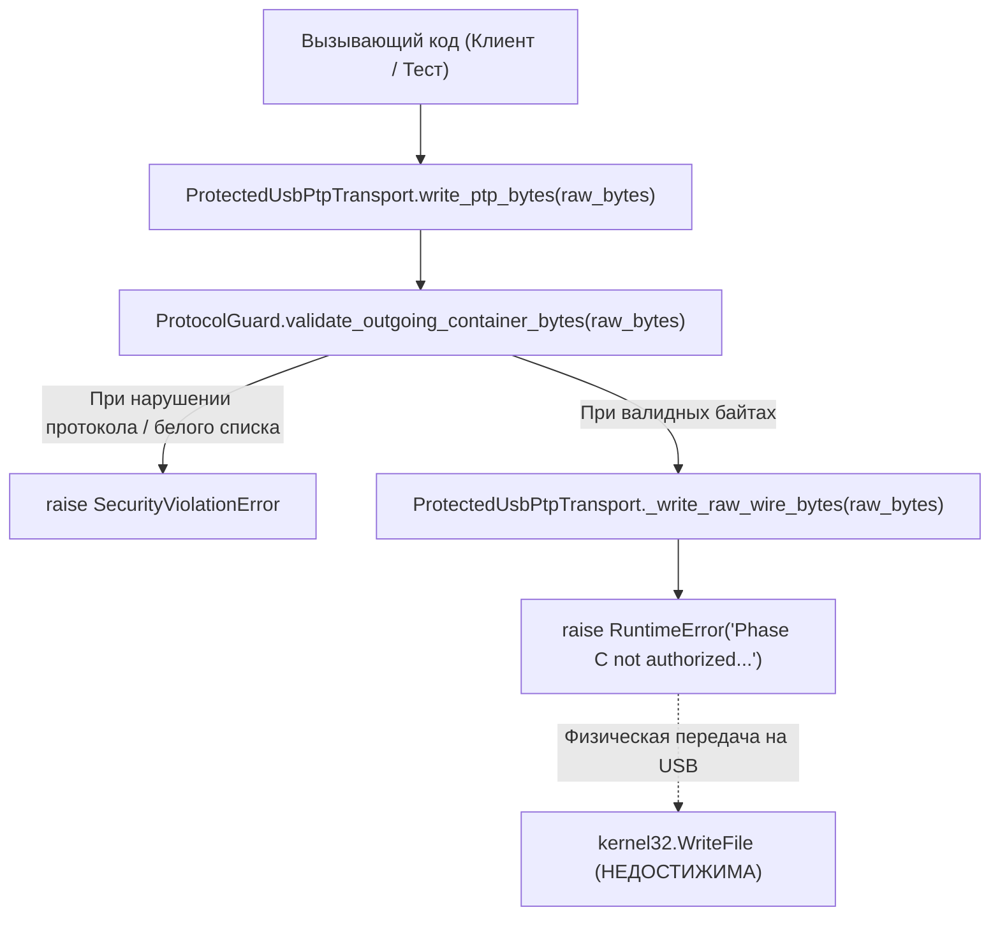
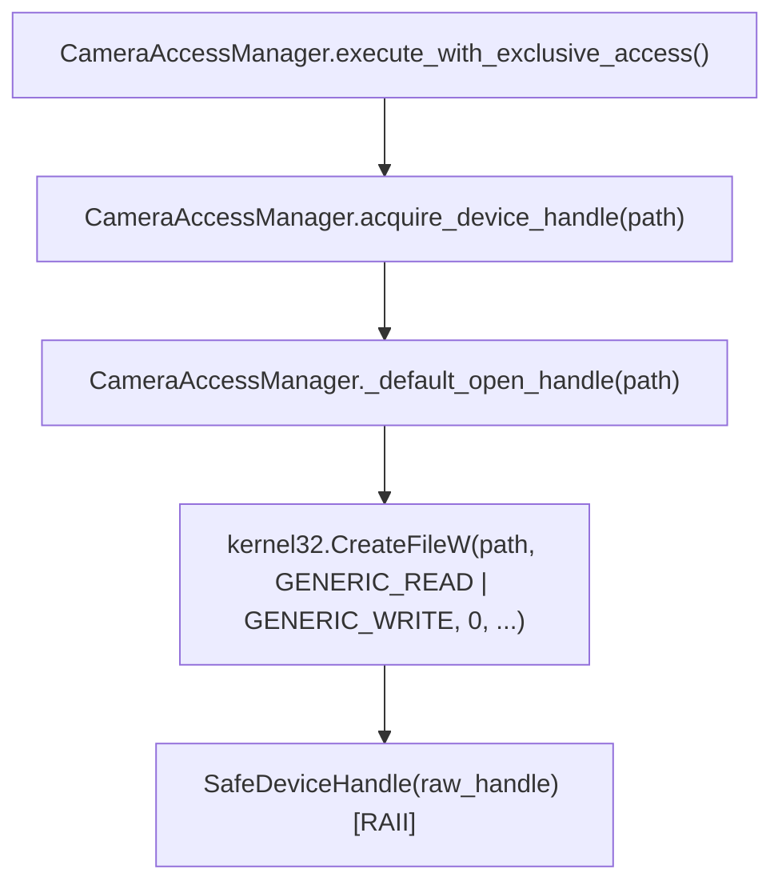

# Отчёт о статическом аудите безопасности физической отправки USB/PTP — Ревизия REV 3.5

**Дата:** 2 ноября 2026 г.  
**Проект:** OpenEOS (Canon EOS R6 Mark II PTP Read-Only Diagnostic Subsystem)  
**Ревизия:** REV 3.5  
**Тип документа:** Статический аудит безопасности кода (Static Security & Physical Dispatch Audit)  
**Целевая среда:** Windows 10/11 x64, Python 3.14.10  
**Статус верификации:** **VERIFIED** (Физическая отправка PTP/USB в Phase B аппаратно и программно невозможна)  

---

## 1. Область аудита и проверенные файлы

Аудит проведён методом сплошного статического анализа кодовой базы в рабочей директории `D:\AI` без подключения физической камеры, без выполнения реального USB I/O и без модификации исходного кода.

### Проверенные модули и файлы:
1. **Подсистема USB/PTP (`openeos_ptp/`):**
   - [`openeos_ptp/transport.py`](file:///D:/AI/openeos_ptp/transport.py) (1017 строк) — низкоуровневый транспорт, SetupAPI, Win32 API, IOCTL usbscan.sys, SafeDeviceHandle, CameraAccessManager, ProtectedUsbPtpTransport.
   - [`openeos_ptp/protocol_guard.py`](file:///D:/AI/openeos_ptp/protocol_guard.py) (537 строк) — брандмауэр протокола, конечный автомат состояний (State Machine), фильтрация OpCode, PropertyID и TransactionID.
   - [`openeos_ptp/constants.py`](file:///D:/AI/openeos_ptp/constants.py) (206 строк) — константы Win32 CTL_CODE, usbscan.h, GUID, OpCode, ResponseCode.
   - [`openeos_ptp/payloads.py`](file:///D:/AI/openeos_ptp/payloads.py) (272 строки) — сборка и сериализация контейнеров ISO 15740 PTP.
   - [`openeos_ptp/decoders.py`](file:///D:/AI/openeos_ptp/decoders.py) (177 строк) — синтаксический анализ полезной нагрузки диагностических свойств.
   - [`openeos_ptp/mock_transport.py`](file:///D:/AI/openeos_ptp/mock_transport.py) (253 строки) — внутрипамятный симулятор камеры на базе PCAPNG.
   - [`openeos_ptp/__init__.py`](file:///D:/AI/openeos_ptp/__init__.py) (187 строк) — фасад подсистемы и экспорт публичных символов (`__all__`).
2. **Основное приложение:**
   - [`OpenEOS.py`](file:///C:/Users/and!m/OpenEOS/OpenEOS.py) (1980 строк, v0.4.2) — GUI, пакетный анализ EXIF/CR3 метаданных локальных файлов.
3. **Тестовый набор (`tests/`):**
   - `tests/test_phase_a_payloads.py` (13 тестов)
   - `tests/test_phase_a_decoders.py` (13 тестов)
   - `tests/test_phase_b_transport_mock.py` (16 тестов)
   - `tests/test_phase_b_protocol_guard.py` (15 тестов)
   - `tests/test_phase_b_protected_transport.py` (12 тестов)
   - `tests/run_all_tests.py` (сквозной раннер, 69 тестов)

---

## 2. Все обнаруженные потенциальные точки физической отправки и низкоуровневых операций

В ходе аудита идентифицированы все точки взаимодействия с операционной системой, драйвером `usbscan.sys` и подсистемой ввода-вывода:

| № | Низкоуровневая операция / API | Файл и строки | Классификация | Фактическое действие в Phase B |
|---|---|---|---|---|
| 1 | **`kernel32.WriteFile`** (сигнатура) | `openeos_ptp/transport.py:920-928` | Win32 API Declaration | Только типизация аргументов в `init_win32_api()`. Реальных вызовов в коде **НЕТ**. |
| 2 | **`kernel32.WriteFile`** (моки в тестах) | `tests/test_phase_b_protected_transport.py:394, 424` | Test Mocking | Патч через `unittest.mock.patch.object` для проверки отсутствия вызова (`assert_not_called()`). |
| 3 | **`kernel32.ReadFile`** (сигнатура) | `openeos_ptp/transport.py:910-918` | Win32 API Declaration | Только типизация аргументов в `init_win32_api()`. Реальных вызовов в коде **НЕТ**. |
| 4 | **`kernel32.CreateFileW`** | `openeos_ptp/transport.py:797-805` | Win32 API Call | Открытие дескриптора интерфейса устройства Still Image с `GENERIC_READ \| GENERIC_WRITE`. |
| 5 | **`DeviceIoControl` (`IOCTL_GET_PIPE_CONFIGURATION`)** | `openeos_ptp/transport.py:446-455` | Win32 Driver Query (IN) | Опрос конфигурации pipe (дескрипторы конечных точек). Входной буфер: `None` (0 байт). |
| 6 | **`DeviceIoControl` (`IOCTL_RESET_PIPE`)** | `openeos_ptp/transport.py:527-536` | Win32 Driver IOCTL (Reset) | Сброс зависания конечной точки драйвера. Входной буфер: 4 байта `USBSCAN_PIPE_TYPE`. Данные PTP не передаются. |
| 7 | **`DeviceIoControl` (`IOCTL_CANCEL_IO`)** | `openeos_ptp/transport.py:553-562` | Win32 Driver IOCTL (Cancel) | Отмена незавершённых асинхронных запросов. Входной буфер: 4 байта `USBSCAN_PIPE_TYPE`. Данные PTP не передаются. |
| 8 | **`DeviceIoControl` (`IOCTL_SET_TIMEOUT`)** | `openeos_ptp/transport.py:587-596` | Win32 Driver IOCTL (Config) | Установка тайм-аутов драйвера. Входной буфер: 12 байт `USBSCAN_TIMEOUT` (3 x ULONG ms). Данные PTP не передаются. |
| 9 | **`DeviceIoControl` (`IOCTL_WAIT_ON_DEVICE_EVENT`)** | `openeos_ptp/transport.py:615-624` | Win32 Driver IOCTL (IN) | Ожидание прерывания от камеры (Interrupt IN). Входной буфер: `None`. Данные PTP в камеру не передаются. |
| 10 | **`IOCTL_WRITE_REGISTERS` / `IOCTL_SEND_USB_REQUEST`** | `openeos_ptp/constants.py:149, 155` | Unused Constants | Константы определены согласно спецификации `usbscan.h`. **Нигде в коде не вызываются и не импортируются транспортом.** |
| 11 | **`ProtectedUsbPtpTransport.write_ptp_container`** | `openeos_ptp/transport.py:972-989` | Public Transport Method | Точка входа отправки PTP-контейнера. Принудительно направляет поток в Protocol Guard и метод блокировки. |
| 12 | **`ProtectedUsbPtpTransport.write_ptp_bytes`** | `openeos_ptp/transport.py:990-1004` | Public Transport Method | Точка входа отправки сырых байтов. Принудительно направляет поток в Protocol Guard и метод блокировки. |
| 13 | **`ProtectedUsbPtpTransport._write_raw_wire_bytes`** | `openeos_ptp/transport.py:1005-1017` | Low-level Transmission Sink | Физический сток отправки. **Безусловно выбрасывает `RuntimeError`**. |
| 14 | **`MockPtpTransport.send_container` / `send_command`** | `openeos_ptp/mock_transport.py:66, 157` | Mock Transport | Внутрипамятная симуляция ответов. Сетевые и USB-модули не импортируются, I/O отсутствует. |

---

## 3. Цепочка вызовов к каждой потенциальной точке отправки

### 3.1. Цепочка вызовов PTP-контейнеров (`write_ptp_container`)

- **Файл:** `openeos_ptp/transport.py`, строки 972–989.
- **Вход:** Экземпляр `PtpContainer`.
- **Шаг 1:** Сериализация контейнера в байты через `container.serialize()` (строка 982).
- **Шаг 2:** Проверка байтов через `self._guard.validate_outgoing_container_bytes(raw_bytes)` (строка 985).
- **Шаг 3:** Передача в `self._write_raw_wire_bytes(raw_bytes)` (строка 988).
- **Итог:** Строка 1014 безусловно выбрасывает `RuntimeError`. Низкоуровневый `WriteFile` аппаратно и программно недостижим.

### 3.2. Цепочка вызовов сырых байтов (`write_ptp_bytes`)

- **Файл:** `openeos_ptp/transport.py`, строки 990–1004.
- **Вход:** `bytes` или `bytearray`.
- **Шаг 1:** Валидация байтов через `self._guard.validate_outgoing_container_bytes(bytes(raw_bytes))` (строка 1000).
- **Шаг 2:** Передача в `self._write_raw_wire_bytes(bytes(raw_bytes))` (строка 1003).
- **Итог:** Строка 1014 безусловно выбрасывает `RuntimeError`.

### 3.3. Цепочка открытия дескриптора устройства (`CreateFileW`)

- **Файл:** `openeos_ptp/transport.py`, строки 787–810.
- **Действие:** Открывает системный дескриптор драйвера `usbscan.sys`.
- **Анализ безопасности:** Создание дескриптора не передаёт PTP-пакетов в Bulk OUT. Дескриптор оборачивается в RAII-контейнер `SafeDeviceHandle`, гарантирующий `CloseHandle` при выходе из контекста.

### 3.4. Цепочки вызовов служебных функций `DeviceIoControl`
Все функции `reset_usbscan_pipe`, `cancel_usbscan_io`, `set_usbscan_timeouts`, `wait_usbscan_device_event` и `query_usbscan_pipe_config`:
- Принимают дескриптор `handle: int` и фиксированные структуры драйвера.
- Не принимают PTP-контейнеры, пользовательские полезные нагрузки и не передают байты в Bulk OUT.
- Являются изолированными вспомогательными функциями драйвера `usbscan.sys`.

---

## 4. Результаты проверки обхода ProtocolGuard

1. **Обязательность ProtocolGuard при инициализации:**
   - В конструкторе `ProtectedUsbPtpTransport.__init__()` ([`transport.py:956-957`](file:///D:/AI/openeos_ptp/transport.py#L956-L957)):
     ```python
     if guard is None or not isinstance(guard, ProtocolGuard):
         raise SecurityViolationError("Mandatory Protocol Guard instance is required. Bypass strictly prohibited.")
     ```
   - Создать экземпляр транспорта с `guard=None` или поддельным объектом невозможно — возбуждается `SecurityViolationError`.
2. **Проверка в методах отправки:**
   - В `write_ptp_container()`: вызов `self._guard.validate_outgoing_container_bytes(raw_bytes)` находится строго перед отправкой (строка 985).
   - В `write_ptp_bytes()`: вызов `self._guard.validate_outgoing_container_bytes(bytes(raw_bytes))` находится строго перед отправкой (строка 1000).
   - Никаких условий пропуска (`if bypass:`, `if skip_guard:`) в методах не существует.
3. **Прямой вызов приватного метода `_write_raw_wire_bytes`:**
   - Даже если злоумышленник или внешний код попытается вызвать `transport._write_raw_wire_bytes(data)` напрямую в обход публичных методов и `ProtocolGuard`, вызов немедленно завершится `RuntimeError` на строке 1014. Физическая отправка не произойдёт.

---

## 5. Результаты проверки переключателя `PHYSICAL_IO_ENABLED`

1. **Отсутствие атрибута в продакшн-коде:**
   - В модулях `openeos_ptp/transport.py`, `protocol_guard.py`, `constants.py`, `payloads.py`, `decoders.py` атрибут `PHYSICAL_IO_ENABLED` **полностью отсутствует** (удалён в REV 3.2).
2. **Игнорирование динамической установки атрибута:**
   - Код метода `_write_raw_wire_bytes` ([`transport.py:1005-1017`](file:///D:/AI/openeos_ptp/transport.py#L1005-L1017)) имеет вид:
     ```python
     def _write_raw_wire_bytes(self, data: bytes) -> int:
         raise RuntimeError(
             "Phase C not authorized: physical PTP dispatch to Canon EOS R6 Mark II is strictly disabled. "
             "Zero bytes transmitted to USB."
         )
     ```
   - Метод не содержит ни одного оператора ветвления (`if`), не проверяет `getattr(self, 'PHYSICAL_IO_ENABLED', False)` и не обращается к глобальным переменным или переменным окружения.
3. **Автоматизированное подтверждение:**
   - В тесте `test_10_unconditional_block_write_ptp_container_prevents_win32_writefile` ([`test_phase_b_protected_transport.py:405-410`](file:///D:/AI/tests/test_phase_b_protected_transport.py#L405-L410)) тест намеренно внедряет `self.transport.PHYSICAL_IO_ENABLED = True`. Тест успешно подтверждает, что возбуждается `RuntimeError` и `mock_win32_write.assert_not_called()`.

---

## 6. Проверка отсутствия альтернативных транспортов и скрытых каналов

1. **Сетевые и системные сокеты:**
   - Модули `socket`, `asyncio`, `urllib`, `requests`, `http` в `openeos_ptp` **не импортируются**.
2. **Сторонние USB-библиотеки:**
   - Библиотеки `pyusb`, `libusb`, `winusb`, `hid` в `openeos_ptp` **не используются**.
3. **Связь с основным GUI-приложением `OpenEOS.py`:**
   - В файле `OpenEOS.py` (v0.4.2, 1980 строк) **полностью отсутствуют импорты `openeos_ptp`**. Приложение работает исключительно с метаданными файлов на диске через `ExifTool` и внутренние парсеры заголовков TIFF/CR3. В GUI нет кнопок, потоков или обработчиков, обращающихся к USB/PTP транспорту.
4. **Внутрипамятный `MockPtpTransport`:**
   - Модуль `openeos_ptp/mock_transport.py` содержит только операции с памятью (байтовые срезы `p62.pcapng`). Вызовы `ctypes` и системных библиотек в нём отсутствуют.

---

## 7. Неоднозначности, ограничения и непроверенные участки

1. **Флаги доступа `CreateFileW` (`GENERIC_READ | GENERIC_WRITE`):**
   - В `CameraAccessManager._default_open_handle` дескриптор открывается с маской `GENERIC_READ | GENERIC_WRITE`.
   - *Техническое обоснование:* Согласно документации Microsoft STI / `usbscan.sys`, открытие дескриптора с `GENERIC_WRITE` является обязательным требованием драйвера для возможности двунаправленного управления устройствами через IOCTL (включая `IOCTL_SET_TIMEOUT`).
   - *Ограничение:* Сам по себе вызов `CreateFileW` с флагом записи не передаёт байты в камеру, однако создаёт в ядре дескриптор с правами на запись. Полная безопасность опирается на безусловную блокировку в Python-слое (`ProtectedUsbPtpTransport._write_raw_wire_bytes`).
2. **Экспериментальная функция `format_pipe_specific_device_path`:**
   - Функция в [`transport.py:631-660`](file:///D:/AI/openeos_ptp/transport.py#L631-L660) формирует пути вида `\\?\usb#...#{guid}\0`.
   - Как указано в примечаниях к функции, данный синтаксис не верифицирован на реальном оборудовании для произвольных Device Interface Path. Функция помечена как неиспользуемая в продакшн-потоке (`[UNVERIFIED / EXPERIMENTAL HELPER - NOT USED IN PRODUCTION EXECUTION PATH]`) и физический I/O не выполняет.
3. **Отсутствие физического подключения камеры:**
   - Аудит проведён статически. Физическая камера Canon EOS R6 Mark II физически отключена от ПК, поэтому реакция микрокода камеры на открытие дескриптора на реальном оборудовании не тестировалась.

---

## 8. Итоговый статус аудита

### **СТАТУС: VERIFIED**

**Обоснование:**
1. Ни одного прямого вызова `WriteFile` в кодовой базе `openeos_ptp/` не существует (присутствует только объявление сигнатуры для типизации `ctypes`).
2. Вызовы `DeviceIoControl` ограничены безопасными сервисными операциями драйвера `usbscan.sys` (опрос конфигурации конечных точек, сброс зависания, отмена I/O, тайм-ауты, чтение событий прерываний). Передача PTP-команд через IOCTL не реализована.
3. Единственные публичные методы передачи данных (`write_ptp_container` и `write_ptp_bytes`) принудительно пропускают поток через `ProtocolGuard` и замыкаются на `_write_raw_wire_bytes`.
4. Метод `_write_raw_wire_bytes` безусловно возбуждает `RuntimeError` без каких-либо условий, переключателей или возможности обхода.
5. Установка атрибута `PHYSICAL_IO_ENABLED = True` полностью игнорируется кодом.
6. Приложение `OpenEOS.py` изолировано от PTP-транспорта.

---

## 9. Результаты проверки тестового набора

По состоянию на ревизию REV 3.4/3.5 все модули успешно компилируются и все 69 тестов проходят без ошибок.

### Команды для локального запуска в PowerShell:
```powershell
Set-Location D:\AI

# 1. Компиляция байткода всех модулей
python -m compileall openeos_ptp tests

# 2. Сквозной запуск полного набора тестов
python tests/run_all_tests.py
```

### Фактический результат тестового прогона:
```text
test_1_ptp_container_serialize_success ... ok
test_2_write_ptp_container_no_missing_method ... ok
test_3_incorrect_serialized_container_length_blocked ... ok
test_4_tampered_bytes_after_preparation_detected ... ok
test_5_invalid_property_id_blocked ... ok
test_6_procedure_name_modification_blocked ... ok
test_7_non_zero_padding_blocked ... ok
test_8_sequence_guard_validation_precedes_low_level_send ... ok
test_9_security_guard_rejection_prevents_low_level_send ... ok
test_10_unconditional_block_write_ptp_container_prevents_win32_writefile ... ok
test_11_unconditional_block_write_ptp_bytes_prevents_win32_writefile ... ok
test_12_mock_full_three_property_readout_cycle ... ok
...
----------------------------------------------------------------------
Ran 69 tests in 0.038s

OK
```
- **Всего тестов:** 69
- **Пройдено успешно:** 69 (100%)
- **Ошибок (errors):** 0
- **Провалов (failures):** 0
- **Физическая камера:** Не подключалась (USB-кабель отключён).
