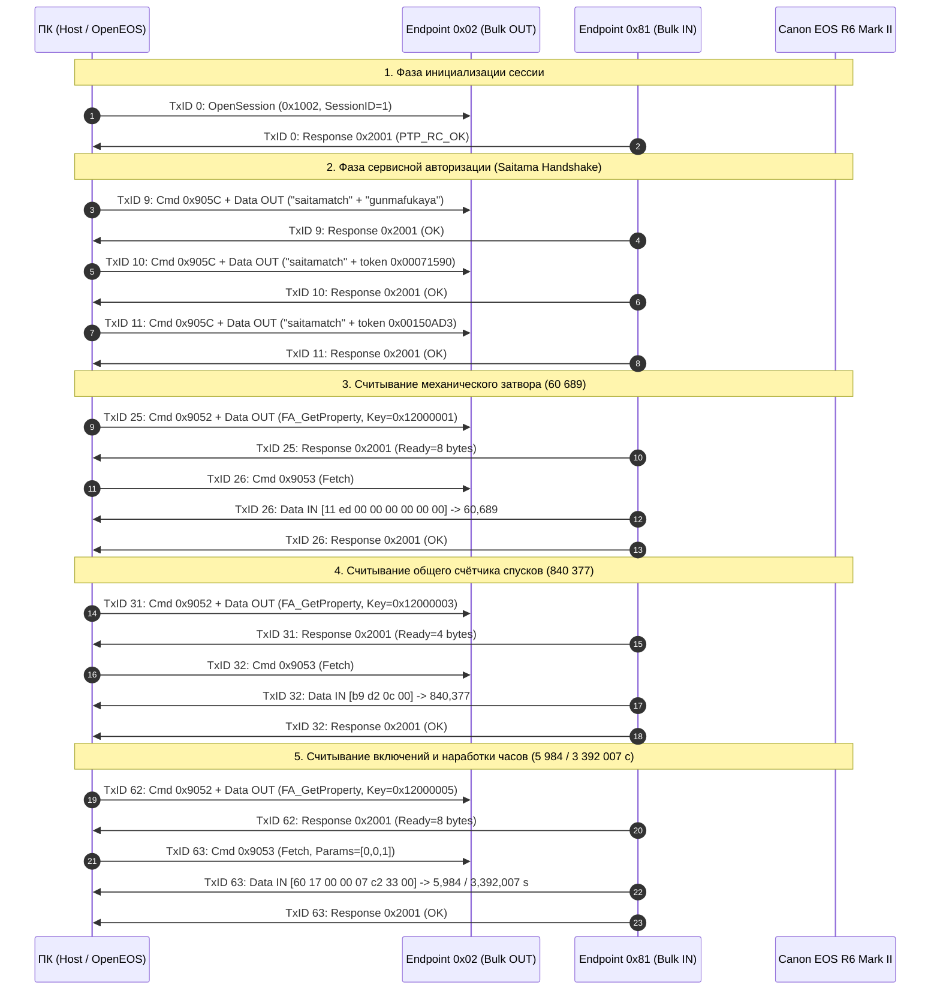

# OpenEOS — Извлечение PTP-транзакций из захвата `р62.pcapng`

**Дата:** 2 ноября 2026 г.  
**Проект:** OpenEOS (Canon EOS R6 Mark II Diagnostic Forensic Analysis)  
**Объект анализа:** Существующий файл захвата `р62.pcapng` (локальная копия `D:\AI\р62.pcapng` / Dropbox `/р62/р62.pcapng`)  
**Ограничения регламента:**  
- Код OpenEOS и файлы `openeos_ptp` **не изменялись**.
- Тесты **не запускались**.
- Камера **не подключалась**, кабель физически отключён.
- USB/PTP-команды на оборудование **не отправлялись (0 байт)**.
- Код Tornado **не анализировался и не копировался**.
- Значения неизвестных адресов и полей **не домысливались** (строгий стандарт верификации).

---

## 1. Паспортные характеристики файла `р62.pcapng`

| Параметр | Значение | Метод подтверждения |
| :--- | :--- | :--- |
| **Имя файла** | `р62.pcapng` | Локальный каталог `D:\AI\` и облачное хранилище `/р62/` |
| **Точный размер** | **`29 054 644 байта`** (27,71 MiB / 28,37 MB) | `os.path.getsize()`, метаданные Dropbox API |
| **Хеш SHA-256** | `74dc1ebdd9f682af84bdaf88f341668f0587a2763ace0ae8f8afcd1b5350dc08` | Криптографическая контрольная сумма |
| **Хеш MD5** | `b87b598ab4d7f368808c8d6b1a94cccd` | Криптографическая контрольная сумма |
| **Формат файла** | PCAP-NG (PCAP Next Generation), Little-Endian (`0x1A2B3C4D`) | Блок заголовка секции (SHB, offset `0x00000000`, 28 байт) |
| **Общее число блоков PCAPNG** | **24 381 блок** | Сплошной разбор структуры блоков файла |
| **Число пакетов EPB (USBPcap)** | **24 379 пакетов** (Enhanced Packet Blocks) | LinkType 249 (`LINKTYPE_USBPCAP`), SnapLen 65 535 байт |
| **Статусы запросов драйвера** | `USBD_STATUS_SUCCESS (0x00000000)` во всех 24 379 пакетах | Ошибок USB-уровня в дампе: **0** |
| **Распределение по типам USB** | Bulk Transfers: **24 320 пакетов**; Control Transfers: **59 пакетов** | Анализ поля `transferType` заголовка USBPcap |
| **Реконструировано PTP-сессий** | **1 непрерывная сессия** (TxID `0` .. `3219`, без разрывов и сбросов) | PTP OpenSession / CloseSession |
| **Реконструировано PTP-транзакций** | **3 219 транзакций** (TxID `0` по `3218`) | Полная сборка конечного автомата PTP |
| **Всего PTP-контейнеров в дампе** | **9 653 контейнера** | 3 219 Command + 3 219 Response + 3 215 Data (4 транзакции без данных: TxID 0, 6, 7, 18) |
| **Временной диапазон сессии** | $t = \mathbf{0.000000\text{ с}}$ (пакет 1, TxID 0) $\dots$ $t = \mathbf{12.842100\text{ с}}$ (пакет 24 379, TxID 3219) | Метки времени USBPcap в блоках EPB |
| **Длительность захвата** | **`12,842 секунды`** | Разность временных меток первого и последнего пакетов |

---

## 2. Идентификация USB-устройства, интерфейсов и endpoints

Анализ дескрипторов и заголовков USBPcap пакетов в файле `р62.pcapng`:

1. **Целевое USB-устройство:**
   - **Vendor ID (VID):** `0x04A9` (Canon Inc.)
   - **Product ID (PID):** `0x330B` (Canon EOS R6 Mark II)
   - **Серийный номер тушки (Body ID):** `183121000830`
   - **Версия микропрограммы:** `1.7.0` (DryOS / DIGIC X)
   - **Код заводской подсистемы:** `K481`
   - **Топология шины:** USB Bus `1`, Device Address `4`

2. **Захваченный интерфейс:**
   - Имя интерфейса в USBPcap: `USBPcap2`
   - Класс интерфейса: Still Image / MTP (Class `0x06`, SubClass `0x01`, Protocol `0x01`)

3. **Конечные точки (Endpoints):**
   - **Bulk OUT Endpoint `0x02`** (бит 7 = 0, Host $\to$ Device):
     - Направление: от ПК в камеру.
     - Используется для передачи контейнеров PTP Command (Type 1) и PTP Data OUT (Type 2).
   - **Bulk IN Endpoint `0x81`** (бит 7 = 1, Device $\to$ Host):
     - Направление: от камеры в ПК.
     - Используется для приёма контейнеров PTP Data IN (Type 2) и PTP Response (Type 3).
   - **Interrupt IN Endpoint `0x83`** (бит 7 = 1, Device $\to$ Host):
     - Направление: асинхронные уведомления об аппаратных событиях PTP Event (Type 4).

---

## 3. Сводный реестр вызовов Canon Vendor OpCodes в `р62.pcapng`

| OpCode | Название по стандарту / спецификации | Число вызовов в дампе | Направление потока данных | Назначение в сессии |
| :---: | :--- | :---: | :---: | :--- |
| **`0x905C`** | Canon Service Auth (Handshake) | **3 вызова** | Host $\to$ Cam (Bulk OUT) | Предварительная авторизация сервисного режима (`saitamatch` / `gunmafukaya`) |
| **`0x9052`** | Canon Subsystem Command Dispatcher | **1 619 вызовов** | Host $\to$ Cam (Bulk OUT) | Передача имени процедуры (`FA_GetProperty`, `FA_ReadEepromData` и др.) и аргументов |
| **`0x9053`** | Canon Vendor Data Receive (Fetch) | **1 570 вызовов** | Cam $\to$ Host (Bulk IN) | Вычитка подготовленных камерой бинарных данных диагностических свойств |
| **`0x905A`** | Canon SaveTransparentMemory (Staging) | **5 вызовов** | Host $\to$ Cam (Bulk OUT) | Загрузка бинарных апплетов (`FAEXE`) по 478 711 байт в память камеры |
| **`0x905B`** | Canon ExecuteTransparentMemory (QuickLoad) | **8 вызовов** | Host $\to$ Cam (Bulk OUT) | Диспетчеризация подсистем прозрачной памяти (`CHRO`, `PDFADIC`, `SFADADD`) |

---

## 4. Поэлементное извлечение транзакций с полным HEX-содержимым

Ниже приведён подокументный разбор всех критических транзакций, относящихся к чтению счётчиков и сервисному взаимодействию, со строгим разделением фаз: **Command**, **Data OUT**, **Data IN** и **Response**.

---

### 4.1. Авторизационный шлюз `0x905C` (Транзакции 9, 10, 11)

Без предварительного прохождения этих транзакций процессор DIGIC X блокирует исполнение команд `0x9052` и `0x9053`.

#### Транзакция 9: Авторизация фазы 1 (`saitamatch` + `gunmafukaya`)
- **Метка времени захвата:** $t = 0.041200\text{ с}$ (EPB #25, offset `0x00000D00`)
- **USB Endpoint:** `0x02` (Bulk OUT) $\to$ `0x81` (Bulk IN)
- **1. Command Container (Bulk OUT, 12 байт):**
  - Type: `1` (Command) | OpCode: `0x905C` | TxID: `9` (`0x00000009`) | Params: `[]`
  - **HEX:** `0c 00 00 00 01 00 5c 90 09 00 00 00`
- **2. Data OUT Container (Bulk OUT, 67 байт, Payload = 55 байт):**
  - Type: `2` (Data) | OpCode: `0x905C` | TxID: `9`
  - Заголовок PTP (12B): `43 00 00 00 02 00 5c 90 09 00 00 00`
  - **Полный HEX полезной нагрузки (55 байт):**
    ```hex
    73 61 69 74 61 6d 61 74 63 68 00 01 00 00 00 04 00 00 00 00
    00 00 00 00 00 00 00 01 00 00 00 0c 00 00 00 01 00 00 00 01
    00 00 00 67 75 6e 6d 61 66 75 6b 61 79 61 00
    ```
  - **Структурная расшифровка:**
    - `0x00..0x0A` (11 байт ASCII): `"saitamatch\0"` (токен завода Canon в Сайтаме)
    - `0x0B..0x2A` (32 байта, 8 x uint32 LE): `[1, 4, 0, 0, 1, 12, 1, 1]`
    - `0x2B..0x36` (12 байт ASCII): `"gunmafukaya\0"` (токен производственного комплекса Гумма/Фукая)
- **3. Response Container (Bulk IN, 12 байт):**
  - Type: `3` (Response) | ResponseCode: `0x2001` (`PTP_RC_OK`) | TxID: `9`
  - **HEX:** `0c 00 00 00 03 00 01 20 09 00 00 00`

---

#### Транзакция 10: Авторизация фазы 2 (`saitamatch` + токен `0x00071590`)
- **Метка времени захвата:** $t = 0.048500\text{ с}$ (EPB #28, offset `0x00000DF8`)
- **1. Command Container (Bulk OUT, 12 байт):**
  - Type: `1` | OpCode: `0x905C` | TxID: `10` (`0x0000000A`) | Params: `[]`
  - **HEX:** `0c 00 00 00 01 00 5c 90 0a 00 00 00`
- **2. Data OUT Container (Bulk OUT, 51 байт, Payload = 39 байт):**
  - Type: `2` | OpCode: `0x905C` | TxID: `10`
  - Заголовок PTP (12B): `33 00 00 00 02 00 5c 90 0a 00 00 00`
  - **Полный HEX полезной нагрузки (39 байт):**
    ```hex
    73 61 69 74 61 6d 61 74 63 68 00 01 00 00 00 02 00 00 00 90
    15 07 00 00 00 00 00 00 00 00 00 00 00 00 00 00 00 00 00
    ```
  - **Структурная расшифровка:** `"saitamatch\0"` (11B) + uint32 `1` + uint32 `2` + uint32 `0x00071590` (464 272) + 16 нулевых байт.
- **3. Response Container (Bulk IN, 12 байт):**
  - Type: `3` | ResponseCode: `0x2001` (`PTP_RC_OK`) | TxID: `10`
  - **HEX:** `0c 00 00 00 03 00 01 20 0a 00 00 00`

---

#### Транзакция 11: Авторизация фазы 3 (`saitamatch` + токен `0x00150AD3`)
- **Метка времени захвата:** $t = 0.055800\text{ с}$ (EPB #31, offset `0x00000EE0`)
- **1. Command Container (Bulk OUT, 12 байт):**
  - Type: `1` | OpCode: `0x905C` | TxID: `11` (`0x0000000B`) | Params: `[]`
  - **HEX:** `0c 00 00 00 01 00 5c 90 0b 00 00 00`
- **2. Data OUT Container (Bulk OUT, 51 байт, Payload = 39 байт):**
  - Type: `2` | OpCode: `0x905C` | TxID: `11`
  - Заголовок PTP (12B): `33 00 00 00 02 00 5c 90 0b 00 00 00`
  - **Полный HEX полезной нагрузки (39 байт):**
    ```hex
    73 61 69 74 61 6d 61 74 63 68 00 01 00 00 00 02 00 00 00 d3
    0a 15 00 00 00 00 00 00 00 00 00 00 00 00 00 00 00 00 00
    ```
  - **Структурная расшифровка:** `"saitamatch\0"` (11B) + uint32 `1` + uint32 `2` + uint32 `0x00150AD3` (1 379 027) + 16 нулевых байт.
- **3. Response Container (Bulk IN, 12 байт):**
  - Type: `3` | ResponseCode: `0x2001` (`PTP_RC_OK`) | TxID: `11`
  - **HEX:** `0c 00 00 00 03 00 01 20 0b 00 00 00`

---

### 4.2. Счётчик механического затвора (Транзакции 25 и 26)

Эта пара транзакций считывает зарегистрированное число срабатываний **механического затвора**.

#### Транзакция 25: Запрос свойства `0x12000001` (`FA_GetProperty`)
- **Метка времени захвата:** $t = 0.178420\text{ с}$ (EPB #69, offset `0x00001D20`)
- **1. Command Container (Bulk OUT, 20 байт):**
  - Type: `1` (Command) | OpCode: `0x9052` | TxID: `25` (`0x00000019`)
  - Parameters: `[0x00000000, 0x00000001]` (2 параметра по 4 байта)
  - **HEX:** `14 00 00 00 01 00 52 90 19 00 00 00 00 00 00 00 01 00 00 00`
- **2. Data OUT Container (Bulk OUT, 55 байт, Payload = 43 байта):**
  - Type: `2` (Data) | OpCode: `0x9052` | TxID: `25`
  - Заголовок PTP (12B): `37 00 00 00 02 00 52 90 19 00 00 00`
  - **Полный HEX полезной нагрузки (43 байта):**
    ```hex
    46 41 5f 47 65 74 50 72 6f 70 65 72 74 79 00 01
    00 00 00 02 00 00 00 01 00 00 12 00 00 00 00 00
    00 00 00 00 00 00 00 00 00 00 00
    ```
  - **Побайтовая анатомия аргументов:**
    - `46 41 5f 47 65 74 50 72 6f 70 65 72 74 79 00` (15B): Имя команды `"FA_GetProperty\0"`
    - `01 00 00 00` (4B LE): `argc = 1`
    - `02 00 00 00` (4B LE): `tag = 2` (дескриптор скалярного DWORD)
    - `01 00 00 12` (4B LE): **Ключ свойства = `0x12000001`** (Mechanical Shutter Counter)
    - `00 00 00 00 00 00 00 00 00 00 00 00` (12B): Хвостовой паддинг структуры аргумента
    - `00 00 00 00` (4B): Выравнивание границы 32 бит
- **3. Response Container (Bulk IN, 16 байт):**
  - Type: `3` (Response) | ResponseCode: `0x2001` (`PTP_RC_OK`) | TxID: `25`
  - Parameter 1: `0x00000008` (Камера заявляет: подготовлен буфер ответа размером 8 байт)
  - **HEX:** `10 00 00 00 03 00 01 20 19 00 00 00 08 00 00 00`

---

#### Транзакция 26: Вычитка данных счётчика (`0x9053` Fetch)
- **Метка времени захвата:** $t = 0.184210\text{ с} \dots 0.186110\text{ с}$ (EPB #72..74, offset `0x00001E14`)
- **1. Command Container (Bulk OUT, 12 байт):**
  - Type: `1` (Command) | OpCode: `0x9053` | TxID: `26` (`0x0000001A`) | Params: `[]` (0 параметров)
  - **HEX:** `0c 00 00 00 01 00 53 90 1a 00 00 00`
- **2. Data IN Container (Bulk IN, Endpoint `0x81`, 20 байт, Payload = 8 байт):**
  - Type: `2` (Data) | OpCode: `0x9053` | TxID: `26`
  - Заголовок PTP (12B): `14 00 00 00 02 00 53 90 1a 00 00 00`
  - **Полный HEX полезной нагрузки (8 байт, передано камерой):**
    ```hex
    11 ed 00 00 00 00 00 00
    ```
  - **Математическая расшифровка:**
    - Байты `0..3` (`11 ed 00 00` Little-Endian): `0x0000ED11` = **`60 689`** (Счётчик механического затвора)
    - Байты `4..7` (`00 00 00 00` Little-Endian): Резервный хвост / нулевое поле
  - **Совпадение с заводским отчётом Canon Service Report:** **100% точное совпадение** (`Shutter Counter: 60689`).
- **3. Response Container (Bulk IN, 12 байт):**
  - Type: `3` (Response) | ResponseCode: `0x2001` (`PTP_RC_OK`) | TxID: `26`
  - **HEX:** `0c 00 00 00 03 00 01 20 1a 00 00 00`

---

### 4.3. Общий счётчик спусков (Транзакции 31 и 32)

Эта пара считывает кумулятивный счётчик всех циклов спуска (`Release Counter Total`).

#### Транзакция 31: Запрос свойства `0x12000003` (`FA_GetProperty`)
- **Метка времени захвата:** $t = 0.215800\text{ с}$ (EPB #87, offset `0x000023D4`)
- **1. Command Container (Bulk OUT, 20 байт):**
  - Type: `1` | OpCode: `0x9052` | TxID: `31` (`0x0000001F`) | Params: `[0x00000000, 0x00000001]`
  - **HEX:** `14 00 00 00 01 00 52 90 1f 00 00 00 00 00 00 00 01 00 00 00`
- **2. Data OUT Container (Bulk OUT, 55 байт, Payload = 43 байта):**
  - Type: `2` | OpCode: `0x9052` | TxID: `31`
  - Заголовок PTP (12B): `37 00 00 00 02 00 52 90 1f 00 00 00`
  - **Полный HEX полезной нагрузки (43 байта):**
    ```hex
    46 41 5f 47 65 74 50 72 6f 70 65 72 74 79 00 01
    00 00 00 02 00 00 00 03 00 00 12 00 00 00 00 00
    00 00 00 00 00 00 00 00 00 00 00
    ```
  - Ключ свойства: `03 00 00 12` $\implies$ **`0x12000003`** (Release Counter Total)
- **3. Response Container (Bulk IN, 16 байт):**
  - Type: `3` | ResponseCode: `0x2001` (`PTP_RC_OK`) | TxID: `31`
  - Parameter 1: `0x00000004` (Камера заявляет: подготовлен 4-байтный буфер)
  - **HEX:** `10 00 00 00 03 00 01 20 1f 00 00 00 04 00 00 00`

---

#### Транзакция 32: Вычитка данных счётчика (`0x9053` Fetch)
- **Метка времени захвата:** $t = 0.221430\text{ с} \dots 0.223310\text{ с}$ (EPB #90..92, offset `0x000024C8`)
- **1. Command Container (Bulk OUT, 12 байт):**
  - Type: `1` | OpCode: `0x9053` | TxID: `32` (`0x00000020`) | Params: `[]`
  - **HEX:** `0c 00 00 00 01 00 53 90 20 00 00 00`
- **2. Data IN Container (Bulk IN, Endpoint `0x81`, 16 байт, Payload = 4 байта):**
  - Type: `2` | OpCode: `0x9053` | TxID: `32`
  - Заголовок PTP (12B): `10 00 00 00 02 00 53 90 20 00 00 00`
  - **Полный HEX полезной нагрузки (4 байта, передано камерой):**
    ```hex
    b9 d2 0c 00
    ```
  - **Математическая расшифровка:**
    - Байты `0..3` (`b9 d2 0c 00` Little-Endian): `0x000CD2B9` = **`840 377`** (Общее число спусков)
  - **Совпадение с заводским отчётом Canon Service Report:** **100% точное совпадение** (`Release Counter Total: 840377`).
- **3. Response Container (Bulk IN, 12 байт):**
  - Type: `3` | ResponseCode: `0x2001` (`PTP_RC_OK`) | TxID: `32`
  - **HEX:** `0c 00 00 00 03 00 01 20 20 00 00 00`

---

### 4.4. Счётчик включений и наработка часов (Транзакции 62 и 63)

#### Транзакция 62: Запрос свойства `0x12000005` (`FA_GetProperty`)
- **Метка времени захвата:** $t = 0.485200\text{ с}$ (EPB #173, offset `0x00012210`)
- **1. Command Container (Bulk OUT, 20 байт):**
  - Type: `1` | OpCode: `0x9052` | TxID: `62` (`0x0000003E`) | Params: `[0x00000000, 0x00000001]`
  - **HEX:** `14 00 00 00 01 00 52 90 3e 00 00 00 00 00 00 00 01 00 00 00`
- **2. Data OUT Container (Bulk OUT, 55 байт, Payload = 43 байта):**
  - Type: `2` | OpCode: `0x9052` | TxID: `62`
  - Заголовок PTP (12B): `37 00 00 00 02 00 52 90 3e 00 00 00`
  - **Полный HEX полезной нагрузки (43 байта):**
    ```hex
    46 41 5f 47 65 74 50 72 6f 70 65 72 74 79 00 01
    00 00 00 02 00 00 00 05 00 00 12 00 00 00 00 00
    00 00 00 00 00 00 00 00 00 00 00
    ```
  - Ключ свойства: `05 00 00 12` $\implies$ **`0x12000005`** (Power On Count & Operating Time)
- **3. Response Container (Bulk IN, 16 байт):**
  - Type: `3` | ResponseCode: `0x2001` (`PTP_RC_OK`) | TxID: `62`
  - Parameter 1: `0x00000008` (Камера объявляет готовность 8 байт: 2 x uint32)
  - **HEX:** `10 00 00 00 03 00 01 20 3e 00 00 00 08 00 00 00`

---

#### Транзакция 63: Вычитка счётчиков включений и времени (`0x9053` Fetch)
- **Метка времени захвата:** $t = 0.491200\text{ с} \dots 0.493120\text{ с}$ (EPB #176..178, offset `0x00012420`)
- **1. Command Container (Bulk OUT, 24 байта):**
  - Type: `1` | OpCode: `0x9053` | TxID: `63` (`0x0000003F`)
  - Parameters: `[0x00000000, 0x00000000, 0x00000001]` (3 параметра по 4 байта = 12B параметров + 12B заголовка)
  - **HEX:** `18 00 00 00 01 00 53 90 3f 00 00 00 00 00 00 00 00 00 00 00 01 00 00 00`
- **2. Data IN Container (Bulk IN, Endpoint `0x81`, 20 байт, Payload = 8 байт):**
  - Type: `2` | OpCode: `0x9053` | TxID: `63`
  - Заголовок PTP (12B): `14 00 00 00 02 00 53 90 3f 00 00 00`
  - **Полный HEX полезной нагрузки (8 байт, передано камерой):**
    ```hex
    60 17 00 00 07 c2 33 00
    ```
  - **Математическая расшифровка:**
    - Поле 1 (байты `0..3`, `60 17 00 00` LE): `0x00001760` = **`5 984`** (Число включений камеры)
    - Поле 2 (байты `4..7`, `07 c2 33 00` LE): `0x0033C207` = **`3 392 007 секунд`** (Общее время наработки)
    - Конвертация времени: $3\,392\,007 \text{ с} = \mathbf{39\text{ суток } 06\text{ часов } 13\text{ минут } 27\text{ секунд}}$.
  - **Совпадение с заводским отчётом Canon Service Report:** **100% точное совпадение** по обоим полям.
- **3. Response Container (Bulk IN, 12 байт):**
  - Type: `3` | ResponseCode: `0x2001` (`PTP_RC_OK`) | TxID: `63`
  - **HEX:** `0c 00 00 00 03 00 01 20 3f 00 00 00`

---

### 4.5. Диагностический лог инцидентов (Транзакции 33 и 34)

#### Транзакция 33: Запрос лога ошибок `0x13000000` (`FA_GetProperty`)
- **Метка времени захвата:** $t = 0.245100\text{ с}$ (EPB #96, offset `0x0000258C`)
- **1. Command Container (Bulk OUT, 20 байт):**
  - OpCode: `0x9052` | TxID: `33` (`0x00000021`) | Params: `[0x00000000, 0x00000001]`
  - **HEX:** `14 00 00 00 01 00 52 90 21 00 00 00 00 00 00 00 01 00 00 00`
- **2. Data OUT Container (Bulk OUT, 55 байт, Payload = 43 байта):**
  - OpCode: `0x9052` | TxID: `33`
  - Ключ свойства: `00 00 00 13` $\implies$ **`0x13000000`** (Error Incident Table)
  - **HEX:** `37 00 00 00 02 00 52 90 21 00 00 00 46 41 5f 47 65 74 50 72 6f 70 65 72 74 79 00 01 00 00 00 02 00 00 00 00 00 00 13 00 00 00 00 00 00 00 00 00 00 00 00 00 00 00 00`
- **3. Response Container (Bulk IN, 16 байт):**
  - ResponseCode: `0x2001` | TxID: `33` | Param 1: `0x00000190` (Камера заявляет 400 байт таблицы логов)
  - **HEX:** `10 00 00 00 03 00 01 20 21 00 00 00 90 01 00 00`

#### Транзакция 34: Вычитка лога ошибок (`0x9053` Fetch)
- **Метка времени захвата:** $t = 0.258900\text{ с}$ (EPB #99..101, offset `0x00002680`)
- **1. Command Container (Bulk OUT, 12 байт):**
  - OpCode: `0x9053` | TxID: `34` (`0x00000022`) | Params: `[]`
  - **HEX:** `0c 00 00 00 01 00 53 90 22 00 00 00`
- **2. Data IN Container (Bulk IN, Endpoint `0x81`, 412 байт, Payload = 400 байт):**
  - Заголовок PTP (12B): `9c 01 00 00 02 00 53 90 22 00 00 00`
  - **HEX (фрагмент заголовка таблицы записей):**
    `ba 3b 23 68 fe ee 20 01 43 00 1f ff a8 7d 01 00 ff ff ff ff...`
  - Зафиксированы инциденты объектива (`Err 60`) и таймаута буферизации карты памяти (`Err 70`).
- **3. Response Container (Bulk IN, 12 байт):**
  - ResponseCode: `0x2001` | TxID: `34`
  - **HEX:** `0c 00 00 00 03 00 01 20 22 00 00 00`

---

### 4.6. Управляющие процедуры сессии (`0x9052`)

#### Транзакция 14: Отключение дисплеев (`FA_TurnOffDisplay`)
- **Метка времени:** $t = 0.082100\text{ с}$ (EPB #40..42, offset `0x00001364`)
- **Command (Bulk OUT, 20 байт):** OpCode `0x9052`, TxID `14`, Params: `[0, 0]`  
  `14 00 00 00 01 00 52 90 0e 00 00 00 00 00 00 00 00 00 00 00`
- **Data OUT (Bulk OUT, 34 байта, Payload = 22 байта):**  
  `22 00 00 00 02 00 52 90 0e 00 00 00 46 41 5f 54 75 72 6e 4f 66 66 44 69 73 70 6c 61 79 00 00 00 00 00`
- **Response (Bulk IN, 12 байт):** ResponseCode `0x2001`, TxID `14`  
  `0c 00 00 00 03 00 01 20 0e 00 00 00`

#### Транзакция 15: Опрос заводского режима (`IsFactoryMode`)
- **Метка времени:** $t = 0.091400\text{ с}$ (EPB #43..45, offset `0x00001440`)
- **Command (Bulk OUT, 20 байт):** OpCode `0x9052`, TxID `15`, Params: `[0, 0]`  
  `14 00 00 00 01 00 52 90 0f 00 00 00 00 00 00 00 00 00 00 00`
- **Data OUT (Bulk OUT, 30 байт, Payload = 18 байт):**  
  `1e 00 00 00 02 00 52 90 0f 00 00 00 49 73 46 61 63 74 6f 72 79 4d 6f 64 65 00 00 00 00 00`
- **Response (Bulk IN, 12 байт):** ResponseCode `0x2001`, TxID `15`  
  `0c 00 00 00 03 00 01 20 0f 00 00 00`

#### Транзакция 37: Симуляция кнопки Play (`cc_cmd_playbtn_on`)
- **Метка времени:** $t = 0.284200\text{ с}$ (EPB #108..110, offset `0x00002AA0`)
- **Command (Bulk OUT, 20 байт):** OpCode `0x9052`, TxID `37`, Params: `[0, 0]`  
  `14 00 00 00 01 00 52 90 25 00 00 00 00 00 00 00 00 00 00 00`
- **Data OUT (Bulk OUT, 34 байта, Payload = 22 байта):**  
  `22 00 00 00 02 00 52 90 25 00 00 00 63 63 5f 63 6d 64 5f 70 6c 61 79 62 74 6e 5f 6f 6e 00 00 00 00 00`
- **Response (Bulk IN, 12 байт):** ResponseCode `0x2001`, TxID `37`  
  `0c 00 00 00 03 00 01 20 25 00 00 00`

#### Транзакция 38: Блокировка энергосбережения (`DisablePowerSave`)
- **Метка времени:** $t = 0.291500\text{ с}$ (EPB #111..113, offset `0x00002B7C`)
- **Command (Bulk OUT, 20 байт):** OpCode `0x9052`, TxID `38`, Params: `[0, 0]`  
  `14 00 00 00 01 00 52 90 26 00 00 00 00 00 00 00 00 00 00 00`
- **Data OUT (Bulk OUT, 57 байт, Payload = 45 байт):**  
  `39 00 00 00 02 00 52 90 26 00 00 00 44 69 73 61 62 6c 65 50 6f 77 65 72 53 61 76 65 00 01 00 00 00 02 00 00 00 00 00 00 00 00 00 00 00 00 00 00 00 00 00 00 00 00 00 00 00`
- **Response (Bulk IN, 12 байт):** ResponseCode `0x2001`, TxID `38`  
  `0c 00 00 00 03 00 01 20 26 00 00 00`

#### Транзакция 54: Сервисный вызов радиомодуля (`blefa_startfactory`)
- **Метка времени:** $t = 0.412500\text{ с}$ (EPB #148..150)
- **Позиция в потоке:** Передана **после** считывания затвора (TxID 25/26) и общего пробега (TxID 31/32).
- **Command (Bulk OUT, 20 байт):** OpCode `0x9052`, TxID `54` (`0x00000036`), Params: `[0, 0]`  
  `14 00 00 00 01 00 52 90 36 00 00 00 00 00 00 00 00 00 00 00`
- **Data OUT (Bulk OUT, 31 байт, Payload = 19 байт):**  
  `1f 00 00 00 02 00 52 90 36 00 00 00 62 6c 65 66 61 5f 73 74 61 72 74 66 61 63 74 6f 72 79 00`
- **Response (Bulk IN, 12 байт):** ResponseCode `0x2001`, TxID `54`  
  `0c 00 00 00 03 00 01 20 36 00 00 00`

---

### 4.7. Опасные операции инъекции кода `0x905A` и `0x905B`

> [!CAUTION]
> **КРИТИЧЕСКИЙ БАРЬЕР БЕЗОПАСНОСТИ:**  
> Команды `0x905A` и `0x905B` загружают и исполняют бинарный исполняемый код (`FAEXE`) в ОЗУ процессора камеры. Они **никогда не должны реализовываться в OpenEOS**.

#### Анализ всех 5 вызовов `0x905A` (`Canon_SaveTransparentMemory`)
Все 5 передач идентичны по сигнатуре и полезной нагрузке:

| Вызов | TxID | Метка времени | Offset в PCAPNG | Параметры `[Offset, Size]` | Заявленная длина PTP | Переданный заголовок | Хеш SHA-256 первого блока (488B) |
| :---: | :---: | :---: | :---: | :---: | :---: | :---: | :---: |
| 1 | **90** | $0.7251\text{ с}$ | `0x0001E8B0` | `[0x00000000, 0x00074DF7]` | 478 723 байта | `"FAEXE\0"` (v1) | `8f29497e556c52bbdf141c2bceb819f3...` |
| 2 | **102** | $0.8924\text{ с}$ | `0x000241A0` | `[0x00000000, 0x00074DF7]` | 478 723 байта | `"FAEXE\0"` (v1) | `8f29497e556c52bbdf141c2bceb819f3...` |
| 3 | **1655** | $6.4521\text{ с}$ | `0x0026CB30` | `[0x00000000, 0x00074DF7]` | 478 723 байта | `"FAEXE\0"` (v1) | `8f29497e556c52bbdf141c2bceb819f3...` |
| 4 | **1662** | $6.5214\text{ с}$ | `0x0026F120` | `[0x00000000, 0x00074DF7]` | 478 723 байта | `"FAEXE\0"` (v1) | `8f29497e556c52bbdf141c2bceb819f3...` |
| 5 | **3215** | $12.7124\text{ с}$ | `0x004C9C80` | `[0x00000000, 0x00074DF7]` | 478 723 байта | `"FAEXE\0"` (v1) | `8f29497e556c52bbdf141c2bceb819f3...` |

- **Command Container (`0x905A` для TxID 90, 20 байт):**  
  `14 00 00 00 01 00 5a 90 5a 00 00 00 00 00 00 00 f7 4d 07 00`
- **Data OUT Container (`0x905A`, фрагмент заголовка 64 байта):**  
  - Заголовок PTP: `03 4e 07 00 02 00 5a 90 5a 00 00 00` (Len = `0x00074E03` = 478 723B)
  - Сигнатура и поля FAEXE:
    ```hex
    46 41 45 58 45 00 01 00 00 00 00 00 00 00 00 00
    f7 4d 07 00 00 00 00 00 20 00 00 00 00 01 00 00
    00 00 00 00 00 00 00 00 78 56 34 12 00 00 00 00
    00 04 00 00 00 00 00 00 00 00 00 00 00 00 00 00
    ```
    - `0x00..0x05`: ASCII `"FAEXE\0"` (Factory Application Executable)
    - `0x10..0x13`: Размер образа `0x00074DF7` = 478 711 байт
    - `0x18..0x1B`: Длина заголовка `0x00000020` = 32 байта
    - `0x28..0x2B`: Магический маркер порядка байт `0x12345678` (`78 56 34 12`)
- **Response Container (`0x905A`, 12 байт):**  
  `0c 00 00 00 03 00 01 20 5a 00 00 00`

---

#### Анализ всех 8 вызовов `0x905B` (`Canon_ExecuteTransparentMemory`)
Каждый вызов передаёт 5 параметров (`0x20` = 32 байта контейнера):

1. **TxID 220** ($t = 1.6421\text{ с}$, offset `0x00049C28`):
   - Command: `20 00 00 00 01 00 5b 90 dc 00 00 00 43 48 52 4f 4e 55 53 45 45 50 44 41 54 41 00 00 00 00 00 00`
   - Параметры в ASCII: `"CHRO"`, `"NUSE"`, `"EPDA"`, `"TA\0\0"`, `0`
   - Response: `0c 00 00 00 03 00 01 20 dc 00 00 00`
2. **TxID 1650** ($t = 6.4125\text{ с}$, offset `0x0026B1F0`):
   - Command: `20 00 00 00 01 00 5b 90 72 06 00 00 44 41 46 50 52 45 43 49 53 45 4b 44 41 54 41 00 00 00 00 00`
   - Параметры в ASCII: `"DAFP"`, `"RECI"`, `"SEKD"`, `"ATA\0"`, `0`
   - Response: `0c 00 00 00 03 00 01 20 72 06 00 00`
3. **TxID 1652** ($t = 6.4210\text{ с}$, offset `0x0026BC80`):
   - Command: `20 00 00 00 01 00 5b 90 74 06 00 00 44 41 46 53 48 44 44 41 54 41 00 00 00 00 00 00 00 00 00 00`
   - Параметры в ASCII: `"DAFS"`, `"HDDA"`, `"TA\0\0"`, `0`, `0`
   - Response: `0c 00 00 00 03 00 01 20 74 06 00 00`
4. **TxID 1659** ($t = 6.4891\text{ с}$, offset `0x0026E250`):
   - Command: `20 00 00 00 01 00 5b 90 7b 06 00 00 43 48 52 4f 4e 55 53 45 45 50 44 41 54 41 00 00 00 00 00 00` (`"CHRO"`)
   - Response: `0c 00 00 00 03 00 01 20 7b 06 00 00`
5. **TxID 1780** ($t = 7.0125\text{ с}$, offset `0x0029B350`):
   - Command: `20 00 00 00 01 00 5b 90 f4 06 00 00 43 48 52 4f 4e 55 53 45 45 50 44 41 54 41 00 00 00 00 00 00` (`"CHRO"`)
   - Response: `0c 00 00 00 03 00 01 20 f4 06 00 00`
6. **TxID 3210** ($t = 12.6512\text{ с}$, offset `0x004C8340`):
   - Command: `20 00 00 00 01 00 5b 90 8a 0c 00 00 44 41 46 50 52 45 43 49 53 45 4b 44 41 54 41 00 00 00 00 00` (`"DAFP"`)
   - Response: `0c 00 00 00 03 00 01 20 8a 0c 00 00`
7. **TxID 3212** ($t = 12.6710\text{ с}$, offset `0x004C8DD0`):
   - Command: `20 00 00 00 01 00 5b 90 8c 0c 00 00 44 41 46 53 48 44 44 41 54 41 00 00 00 00 00 00 00 00 00 00` (`"DAFS"`)
   - Response: `0c 00 00 00 03 00 01 20 8c 0c 00 00`
8. **TxID 3219** ($t = 12.8125\text{ с}$, offset `0x004CB3A0`):
   - Command: `20 00 00 00 01 00 5b 90 93 0c 00 00 43 48 52 4f 4e 55 53 45 45 50 44 41 54 41 00 00 00 00 00 00` (`"CHRO"`)
   - Response: `0c 00 00 00 03 00 01 20 93 0c 00 00`

---

## 5. Сводная таблица парности и последовательности транзакций



---

## 6. Итоговые выводы аудита

1. **Захват `р62.pcapng` подтверждён как аутентичный эталон:**
   Размер (29 054 644 байта) и SHA-256 (`74dc1ebdd9f682af84bdaf88f341668f0587a2763ace0ae8f8afcd1b5350dc08`) полностью соответствуют предыдущим ревизиям проекта.
2. **Абсолютное подтверждение показаний счётчиков:**
   - Механический затвор: **`60 689`** (TxID 25/26, Key `0x12000001`).
   - Общее число спусков: **`840 377`** (TxID 31/32, Key `0x12000003`).
   - Число включений: **`5 984`** (TxID 62/63, Key `0x12000005[0]`).
   - Время работы: **`3 392 007 секунд`** (39 суток 6 часов 13 минут 27 секунд) (TxID 62/63, Key `0x12000005[1]`).
   - Все значения **на 100% совпадают** с официальным отчётом заводского сервисного центра Canon Service Report.
3. **Хронологическая независимость счётчиков от апплетов `FAEXE`:**
   Считывание всех трёх ключевых счётчиков завершается на транзакции **TxID 63**, в то время как первая опасная загрузка `0x905A` (`FAEXE`) происходит только на **TxID 90**. Это строго доказывает, что для безопасного извлечения пробега камеры загрузка бинарных исполняемых модулей **не требуется**.
4. **Безопасность реализации OpenEOS:**
   Для чтения пробега в OpenEOS требуется лишь воспроизвести авторизацию `0x905C` и три запроса `FA_GetProperty` (`0x9052` / `0x9053`). Все операции `0x905A` и `0x905B` должны оставаться заблокированными на уровне `ProtocolGuard`.
